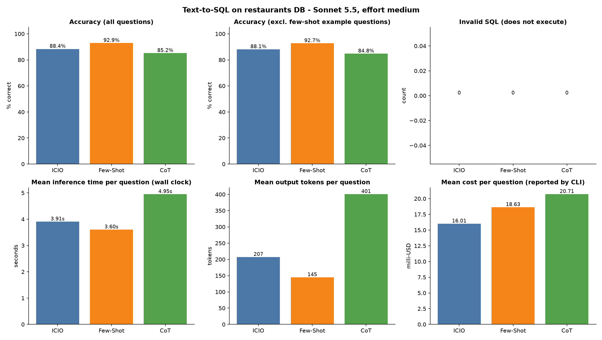
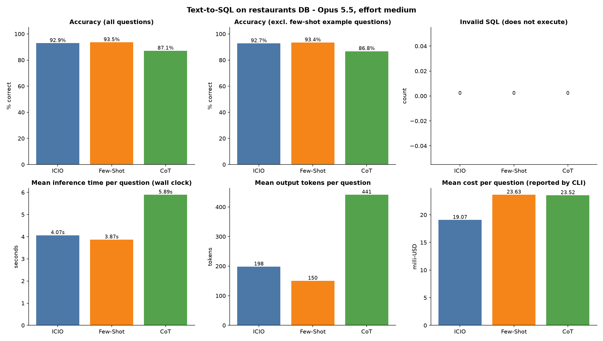

# Task 2 – Comparison of the prompts on text-to-SQL

## How I did it
I asked Sonnet 5.5 (in Claude Code) to write one script, `run_task2.py`. The script takes the three prompts from Task 1, and for each of the 155 questions it calls `claude -p` with Sonnet 5.5 (medium effort). Every call is a new, separate session (no history, no tools, no settings), so the prompts do not influence each other. The script measures the inference time and token usage of every call, runs the predicted SQL on the database, compares the returned rows with the labels (same rule as the provided evaluator) and saves everything.

- Model: Sonnet 5.5, effort medium. 155 questions × 3 prompts = 465 calls, one run per prompt, 4 calls in parallel. Later I ran the same 465 calls with a second model, Opus 5.5 (effort medium), see below.
- Outputs (folders `output/sonnet-5.5/` and `output/opus-5.5/`): `predictions_prompt_a|b|c.csv` (predictions with model and prompt metadata, time, tokens, correct/wrong), `raw_*.jsonl` (raw answers), `summary.csv`, `report.md`, `comparison.png`.
- Time is the wall clock of the whole CLI call, so it includes the start of the CLI. Cost and prompt tokens depend on what was read from the cache, so I take them only as a rough hint.

## Results

| Prompt | Accuracy | Correct | Invalid SQL | Mean time | P95 time | Mean output tokens | Total cost |
|---|---|---|---|---|---|---|---|
| ICIO | 88.4 % | 137/155 | 0 | 3.91 s | 5.52 s | 207 | $2.48 |
| Few-Shot | **92.9 %** | 144/155 | 0 | **3.60 s** | 5.74 s | **145** | $2.89 |
| CoT | 85.2 % | 132/155 | 0 | 4.95 s | 6.62 s | 401 | $3.21 |

Four questions are used as examples inside the Few-Shot prompt. When they are excluded the accuracies are 88.1 % / 92.7 % / 84.8 %, so it did not change anything.

## What the results say
- **Few-Shot** was the most accurate and also the fastest, with the shortest answers. The examples showed the model the exact pattern, so it answered shortly and mostly correctly.
- **CoT** was the worst and the slowest. It writes 2–3× more output tokens than the others and costs more. For such a simple task the model does not profit from the extra steps. (Prompt C was modified because of the CLI block, see the Task 1 report.)
- **ICIO** was in the middle in accuracy and the cheapest. Maybe it would profit from examples.
- No prompt produced an invalid SQL, so all errors are logical errors (the SQL runs but returns different rows).
- The differences are small (3–6 questions between the prompts) and it is one run on 155 questions, so the ranking is a hint and not a proof. Statistical testing is for Task 4.

## Where it went wrong
130 questions were solved by all three prompts and 10 by none of them. I looked at those 10:
- **7 questions** (e.g. "restaurants in alameda with a rating above 2"): the model filtered the city with `RESTAURANT.CITY_NAME`, the labels use `LOCATION.CITY_NAME`. It returned a few rows too many (or none, for the city "unknown"). The prompt did not say which of the two city columns to use, so this is a weakness of my prompts, not of the model.
- **2 questions**: the model split a literal value of the data. A street is stored as `"shellmound st # 12"` and the model made a street and a house number 12 out of it; the food type `"vietnamese/louisiana"` is one value and the model split it in two.
- **1 question** ("What is the lifes greates illusion?"): nonsense question whose label returns all restaurants, the model returned an empty result. This is a label problem.

So 100 % was probably not reachable, but most of the misses are not caused by bad labels. A possible improvement is to state in the prompt which city column to use and that street names and food types are single literal values. I did not test it, so I do not know how much it would help.

## Second model: Opus 5.5 (effort medium)
Same prompts, same questions, same script (`run_task2.py --model opus`), outputs in `output/opus-5.5/`. The run was interrupted once by the usage limit of my Claude plan; the failed calls were repeated later, so every question has exactly one valid answer per prompt.

| Prompt | Accuracy | Correct | Invalid SQL | Mean time | P95 time | Mean output tokens | Total cost |
|---|---|---|---|---|---|---|---|
| ICIO | 92.9 % | 144/155 | 0 | 4.07 s | 6.18 s | 198 | $2.96 |
| Few-Shot | **93.5 %** | 145/155 | 0 | **3.87 s** | 6.01 s | **150** | $3.66 |
| CoT | 87.1 % | 135/155 | 0 | 5.89 s | 9.14 s | 441 | $3.65 |

- Opus is better than Sonnet with every prompt, most with ICIO (+4.5 points, 137 → 144 correct). With Opus, ICIO and Few-Shot are almost equal.
- Opus is slower (about 0.2–0.9 s more per question) and more expensive (about 14–27 % per question).
- The order Few-Shot ≥ ICIO > CoT stays the same. CoT is again the slowest and least accurate.
- The statistical comparison of the two models is in Task 4.

