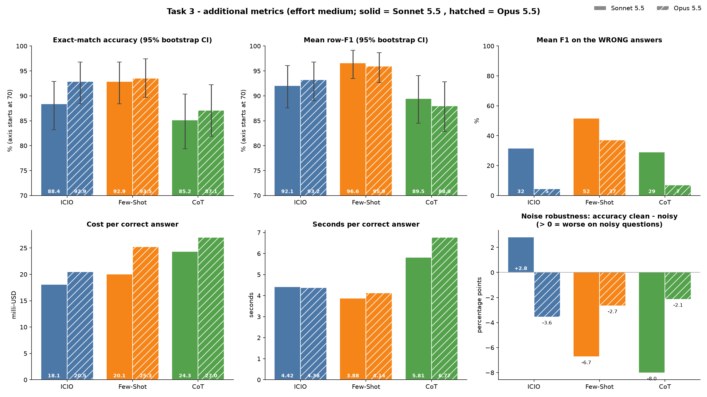

# Task 3 – Additional metrics for the text-to-SQL prompt comparison

Code: [metrics.py](metrics.py) · Outputs: `output/metrics_summary.csv`, `output/metrics_per_question.csv`, `output/metrics_summary.json`, `output/metrics_comparison.png`
Run: `cd Task_3 && ../Task_2/.venv/bin/python metrics.py` (no model calls; it re-executes the saved predictions from Task 2 on the database). The metrics are computed for both models of Task 2, **Sonnet 5.5** and **Opus 5.5** (effort medium).

## 1. Why another metric
The original metric of the problem is **exact match** of the returned rows (accuracy). It is the right definition of "correct", but it has two blind spots, both visible in our Task 2 results:

1. **All or nothing.** A query that returns 63 rows instead of 62 gets the same 0 as a completely wrong query. Several of our "wrong" answers were this close.
2. **It ignores what the answer costs.** Few-Shot, ICIO and CoT differ strongly in output length, time and price, but accuracy says nothing about it. In practice a prompt is chosen by quality *and* cost.

I therefore propose three metrics. A and B were chosen as the main ones, C is an additional diagnostic.

## 2. The metrics

### B – Row-level F1 (partial credit)
Let P be the multiset of rows returned by the predicted SQL and E the multiset of expected rows. Precision = |P∩E| / |P|, recall = |P∩E| / |E|, F1 = harmonic mean. If both are empty the F1 is 1 (the model correctly returned nothing). Multisets are used so that duplicate rows count, exactly like the original evaluator. Invalid SQL would give 0 (there were none).
- Why it fits: the task is *retrieval*. Returning almost all the right restaurants plus one extra is much better than returning nothing, and F1 says so. Precision shows over-retrieval (extra rows), recall shows missed rows.
- I also report the **mean F1 on the wrong answers only**, which tells how "near misses" the errors are.

### A – Efficiency: cost per correct answer
For every prompt: total cost, total billed tokens (input + cache write + cache read + output), total time, each **divided by the number of correct answers** (and the inverse, correct answers per dollar). This answers "what do I pay for one correct query?". It uses the cost, token and time values that the Task 2 script already measured for every call.

### C – Noise robustness (diagnostic)
Part of the questions contain an irrelevant sentence (picnics, pancakes, ...). I flag a question as *noisy* with a keyword heuristic (44 of 155 flagged, 111 clean) and compare accuracy on the two groups. The drop from clean to noisy shows how well a prompt ignores distractors.

### Uncertainty
For accuracy and mean F1 I add 95 % bootstrap confidence intervals (5000 resamples of the 155 questions), because with 155 questions a difference of a few points is easy to over-read.

## 3. Results

| Model | Prompt | Accuracy (exact) [95 % CI] | Mean row-F1 [95 % CI] | Mean F1 of wrong answers | Wrong answers with F1 > 0 | Cost / correct | Billed tokens / correct | Time / correct |
|---|---|---|---|---|---|---|---|---|
| Sonnet 5.5 | ICIO | 88.4 % [83.2, 92.9] | 0.921 [0.876, 0.961] | 0.32 | 6 of 18 | **$0.0181** | 3 842 | 4.42 s |
| Sonnet 5.5 | Few-Shot | 92.9 % [88.4, 96.8] | **0.966** [0.935, 0.992] | **0.52** | 6 of 11 | $0.0201 | 3 562 | **3.88 s** |
| Sonnet 5.5 | CoT | 85.2 % [79.4, 90.3] | 0.895 [0.845, 0.941] | 0.29 | 8 of 23 | $0.0243 | 5 009 | 5.81 s |
| Opus 5.5 | ICIO | 92.9 % [88.4, 96.8] | 0.932 [0.890, 0.968] | 0.05 | 2 of 11 | $0.0205 | 3 846 | 4.38 s |
| Opus 5.5 | Few-Shot | **93.5 %** [89.7, 97.4] | 0.959 [0.927, 0.986] | 0.37 | 5 of 10 | $0.0253 | 4 485 | 4.14 s |
| Opus 5.5 | CoT | 87.1 % [81.9, 92.3] | 0.880 [0.828, 0.928] | 0.07 | 5 of 20 | $0.0270 | **3 428** | 6.77 s |

Paired comparison of F1 on the same questions (how many questions one prompt scores higher on; the rest are ties):

| Pair | Sonnet: first better / second better / tie | Opus: first better / second better / tie |
|---|---|---|
| Few-Shot vs ICIO | 8 / 1 / 146 | 8 / 7 / 140 |
| Few-Shot vs CoT | 12 / 0 / 143 | 14 / 5 / 136 |
| ICIO vs CoT | 7 / 3 / 145 | 13 / 3 / 139 |

Noise robustness (accuracy, clean / noisy; 111 clean, 44 noisy questions):

| Prompt | Sonnet 5.5 | Opus 5.5 |
|---|---|---|
| ICIO | 89.2 % / 86.4 % | 91.9 % / 95.5 % |
| Few-Shot | 91.0 % / 97.7 % | 92.8 % / 95.5 % |
| CoT | 82.9 % / 90.9 % | 86.5 % / 88.6 % |

## 4. What the metrics tell us
- **With Sonnet, row-F1 confirms the ranking of accuracy** (Few-Shot > ICIO > CoT) and the gaps are of similar size, so for this dataset it does not change the conclusion. Most predictions are either exactly right or very close, and the confidence intervals of the prompts overlap, so the F1 alone cannot prove that the prompts differ either. The paired counts are more convincing: Few-Shot is better than CoT on 12 questions and worse on none, and better than ICIO on 8 versus 1. ICIO vs CoT (7 vs 3) is too close to call.
- **The wrong answers differ in quality.** With Sonnet, Few-Shot's errors are the closest misses (mean F1 0.52), ICIO and CoT often fail completely (0.32, 0.29). Only 6 of 18 ICIO errors and 8 of 23 CoT errors were partially right, which shows that most failures are real misses (e.g. an empty result because the wrong city column was filtered), not small over-retrieval.
- **Efficiency changes the picture slightly.** With Sonnet, Few-Shot is the best in time and tokens per correct answer, CoT is the worst on everything (about 1.2–1.5× the cost, billed tokens and time of the others per correct answer). In **cost per correct answer ICIO is the cheapest**, although Few-Shot is more accurate and faster. The reason is the price structure: the Few-Shot prompt is longer and the CLI reports a higher cost for writing it to the cache. Cost and billed tokens depend on the cache state of each call and the runs were parallel, so I trust time and output tokens more than the dollar value.
- **With Opus, F1 separates prompts that accuracy cannot.** Opus ICIO and Opus Few-Shot have almost the same accuracy (92.9 % vs 93.5 %), but F1 is clearly higher for Few-Shot (0.959 vs 0.932). Opus's ICIO errors are complete misses (mean F1 of wrong answers 0.05, only 2 of 11 partly right): it returns nothing because it rewrote a value or left a filter out (e.g. `'afghani'` → `'afghan'`, the food type "dinner" dropped). Few-Shot's errors stay close (0.37). This is exactly the information exact match hides.
- **The models fail differently.** Sonnet's wrong answers are often near misses (a few extra rows), Opus's wrong answers are more often empty results (F1 of wrong answers 0.05–0.37 vs 0.29–0.52). Opus "corrects" the user's wording more often, which is right when the data follow normal English and wrong when they do not.
- **Efficiency of the models.** Opus costs more per correct answer with every prompt (+11 % to +26 %) and is slower per correct answer except with ICIO, where its higher accuracy compensates (4.38 s vs 4.42 s). The best value for money in this experiment is Sonnet with ICIO (cheapest) or Sonnet with Few-Shot (fastest, best F1).
- **Noise robustness did not discriminate.** No prompt got worse on noisy questions in a meaningful way (Few-Shot and CoT were even better on them). The noisy questions are mostly simple template questions, and the hard questions in the dataset (city, street, region) are in the clean group, so the groups are not comparable. The only sign of a drop is ICIO (−2.8 points, about one question out of 44). Opus shows the same: no prompt is worse on noisy questions. The honest conclusion is that all three prompts, with both models, ignore the distractor sentences well. The metric is useful as a check, but not as a ranking criterion here. The keyword heuristic for "noisy" is also approximate.

## 5. Complement or replace?
- **Row-F1 complements exact match, it does not replace it.** For SQL, exact match is the real definition of a correct answer: a query that misses one restaurant is still the wrong query. F1 adds information (how close the errors are, over- vs. under-retrieval), and is useful for analysing and improving prompts, but should not be reported as "accuracy".
- **Cost per correct answer complements accuracy** and should be read together with it (e.g. as accuracy vs. cost). A cheap prompt with a low accuracy would look good in cost per correct only if it is also right often enough, which is why the metric divides by correct answers and not by all answers.
- **Noise robustness is a diagnostic**, useful on datasets where the noise is spread evenly over question types.

## 6. Limitations
- One run per prompt and model on 155 questions; the confidence intervals are wide and overlap. Statistical testing of the differences is part of Task 4.
- Some labels are doubtful (e.g. the nonsense question whose label returns all restaurants), which affects every metric the same way.
- Cost and token figures depend on caching and on how the CLI reports them.
