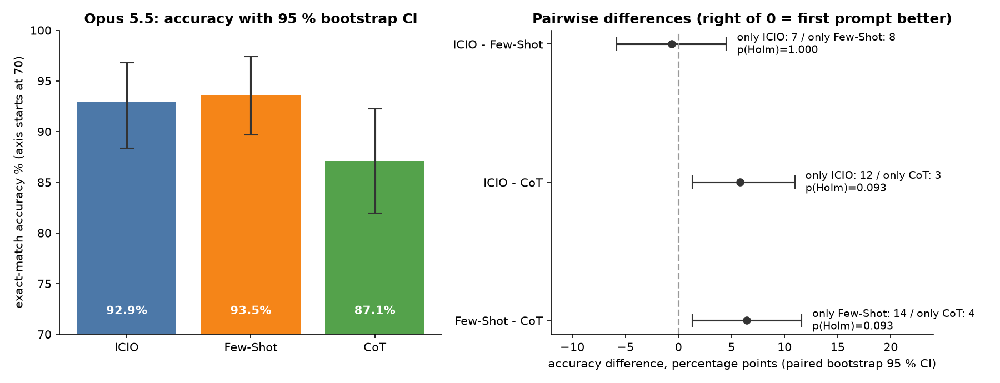
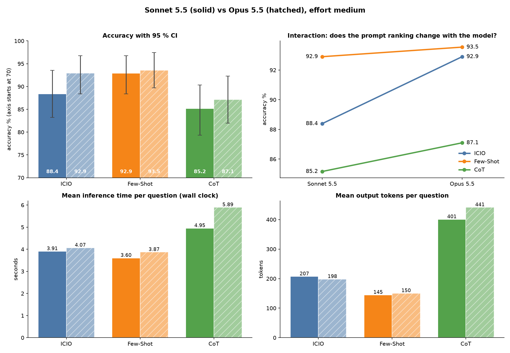
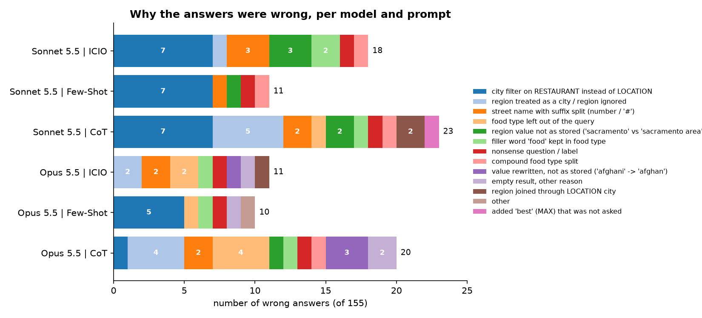

# Task 4 – Detailed analysis of the prompt comparison (Sonnet 5.5 and Opus 5.5)

Code: [analysis.py](analysis.py) · Generated tables: [output/sonnet-5.5/tables.md](output/sonnet-5.5/tables.md), [output/opus-5.5/tables.md](output/opus-5.5/tables.md), [output/model_comparison/tables.md](output/model_comparison/tables.md) (plus `stats_results.json`, `error_causes_per_question.csv` in each folder) · Figures: `output/<model>/fig1…fig5`, `output/model_comparison/fig6…fig7`
Run: `cd Task_4 && ../Task_2/.venv/bin/python analysis.py` (uses only the saved results of Tasks 2 and 3, no new model calls).

## 1. Data and method
Text-to-SQL on the restaurants database, 155 labelled questions, three prompts (ICIO, Few-Shot, CoT), two models, **Sonnet 5.5** and **Opus 5.5** (both effort medium), called through the Claude Code CLI, one run per prompt and model, one fresh session per call (Task 2). The same 155 questions were given to every prompt and model, so all comparisons are **paired**. Sections 2.1–2.2 analyse the prompts with Sonnet, section 2.3 repeats it with Opus, and section 3.3 compares the models.

Tests used:
- **Accuracy (correct/wrong per question):** Cochran's Q for the three prompts together, then exact McNemar tests for each pair (these use only the questions on which two prompts disagree).
- **Row-F1, time, tokens, cost (numeric, paired):** Friedman test, then pairwise Wilcoxon signed-rank tests.
- **Multiple comparisons:** Holm correction over the three pairs of each metric (no correction across metrics).
- **Model comparison:** for each prompt, exact McNemar (accuracy) and Wilcoxon (numeric metrics) between Sonnet and Opus on the same questions, Holm over the three prompts; Cochran's Q over all six prompt × model conditions; for the interaction, the change of the gap between two prompts from one model to the other, with a paired bootstrap interval.
- **Effect sizes:** differences with 95 % paired bootstrap confidence intervals (10 000 resamples of questions).

## 2. Results

Sonnet 5.5:

| Prompt | Accuracy [95 % CI] | Row-F1 | Mean time | Median time | Output tokens | Cost / question |
|---|---|---|---|---|---|---|
| ICIO | 88.4 % [83.2, 92.9] | 0.921 | 3.91 s | 3.44 s | 207 | $0.0160 |
| Few-Shot | 92.9 % [88.4, 96.8] | 0.966 | 3.60 s | 3.22 s | 145 | $0.0186 |
| CoT | 85.2 % [79.4, 90.3] | 0.895 | 4.95 s | 4.51 s | 401 | $0.0207 |

### 2.1 Is the difference statistically significant? (Sonnet 5.5)

**Accuracy.** Cochran's Q = 14.53, df = 2, **p = 0.0007**: the three prompts do not all perform the same.

| Pair | questions only A solved / only B solved | difference A − B [95 % CI] | p | p (Holm) |
|---|---|---|---|---|
| ICIO vs Few-Shot | 1 / 8 | −4.5 pt [−8.4, −1.3] | 0.039 | **0.078** |
| ICIO vs CoT | 7 / 2 | +3.2 pt [−0.6, +7.1] | 0.180 | 0.180 |
| Few-Shot vs CoT | 12 / 0 | +7.7 pt [+3.9, +12.3] | 0.0005 | **0.0015** |

- **Few-Shot > CoT is significant** even after correction (12 questions where only Few-Shot is right, none the other way).
- **Few-Shot > ICIO is suggestive but not significant after Holm correction** (raw p = 0.039, adjusted 0.078). On the row-F1 metric the same pair is significant (p Holm = 0.039), so the evidence is borderline, not absent.
- **ICIO vs CoT is not distinguishable** (7 vs 2 discordant questions, the interval contains 0). Not significant does not mean equal: with only 9 disagreeing questions the test has little power.

**Row-F1** gives the same picture: Friedman p = 0.0011; Few-Shot − CoT +0.071 (p Holm = 0.003), Few-Shot − ICIO +0.045 (0.039), ICIO − CoT +0.026 (0.18).

**Time and tokens.** Differences are highly significant for every pair (all p Holm < 1e-7 for wall time, API time and output tokens): CoT is slower by about 1.0–1.3 s per question and writes 190–260 more output tokens; Few-Shot is faster than ICIO by 0.30 s [0.13, 0.47] and writes 62 fewer tokens. These are consistent length effects (the prompts make the answer longer or shorter on almost every question), so significance is not surprising; what matters is the size: CoT costs about 1.4× the time of Few-Shot and 2.8× its output tokens. **Cost and billed tokens** I do not interpret: they depend on cache writes and reads, which are very uneven between calls (the bootstrap interval of the mean difference of billed tokens contains 0 while the rank test is significant, a sign of a few large cache outliers). Only ICIO being the cheapest per question is stable.

### 2.2 Where the prompts agree and disagree (Sonnet 5.5)

130 of 155 questions are solved by all three prompts and 10 by none. Only 15 questions separate the prompts: Few-Shot alone solves 6, ICIO and Few-Shot together 6 (CoT fails), Few-Shot with CoT 2 (ICIO fails), ICIO alone 1. The ranking is therefore decided by roughly a dozen questions.

By question type (automatic classification of the question text):

| Type | n | ICIO | Few-Shot | CoT |
|---|---|---|---|---|
| city + rating | 40 | 82.5 % | 82.5 % | 82.5 % |
| best | 12 | 100 % | 100 % | 91.7 % |
| street | 48 | 91.7 % | 97.9 % | 93.8 % |
| region | 44 | 86.4 % | 95.5 % | 75.0 % |
| other | 11 | 90.9 % | 90.9 % | 90.9 % |

The prompts are identical on city questions and differ mainly on **region** questions (CoT 75 %, Few-Shot 95 %) and, less, on street questions.

### 2.3 The same analysis with Opus 5.5

| Prompt | Accuracy [95 % CI] | Row-F1 | Mean time | Median time | Output tokens | Cost / question |
|---|---|---|---|---|---|---|
| ICIO | 92.9 % [88.4, 96.8] | 0.932 | 4.07 s | 3.61 s | 198 | $0.0191 |
| Few-Shot | 93.5 % [89.7, 97.4] | 0.959 | 3.87 s | 3.40 s | 150 | $0.0236 |
| CoT | 87.1 % [81.9, 92.3] | 0.880 | 5.89 s | 5.48 s | 441 | $0.0235 |

Cochran's Q = 7.58, df = 2, **p = 0.023**.

| Pair | only A / only B | difference A − B [95 % CI] | p | p (Holm) |
|---|---|---|---|---|
| ICIO vs Few-Shot | 7 / 8 | −0.6 pt [−5.8, +4.5] | 1.00 | 1.00 |
| ICIO vs CoT | 12 / 3 | +5.8 pt [+1.3, +11.0] | 0.035 | 0.093 |
| Few-Shot vs CoT | 14 / 4 | +6.5 pt [+1.3, +11.6] | 0.031 | 0.093 |

- With Opus, **ICIO and Few-Shot are equal** (7 vs 8 questions).
- **Both are better than CoT** by about 6 points. The difference is significant before the Holm correction, not after it (p Holm = 0.093). On row-F1, Few-Shot > CoT is significant (p Holm = 0.008).
- Time and tokens behave as with Sonnet: CoT is about 2 s slower than the other two and writes about 2.5× more output tokens (all p Holm < 1e-20).
- 128 questions are solved by all three prompts and only 3 by none (Sonnet: 130 and 10).
- By question type, ICIO is now perfect on the city questions (100 %), and CoT is again weakest on region questions (79.5 % vs 97.7 % for Few-Shot). Figures: [fig2](output/opus-5.5/fig2_agreement.png), [fig3](output/opus-5.5/fig3_question_types.png), [fig4](output/opus-5.5/fig4_error_causes.png), [fig5](output/opus-5.5/fig5_time_and_tradeoff.png).

## 3. Why are the prompts different? Prompt, model and agent as factors

### 3.1 Why the errors happen (Sonnet 5.5, all prompts)
I classified every wrong answer by inspecting its SQL (automatic rules, then checked by hand on the shared failures; the cause "city filter" was verified by re-running the SQL with the corrected column).

- **The same 7 questions fail in all three prompts** because the question's city is filtered with `RESTAURANT.CITY_NAME` while the labels use `LOCATION.CITY_NAME`. Switching the column fixes all of them. No prompt told the model which one to use, and the choice the model made is the natural reading of the schema, so this is an **information gap in the prompts, not a reasoning or model failure**. It is the largest cause (7 of 11 errors of Few-Shot) and the floor shared by all prompts.
- One question is nonsense and its label returns every restaurant (label problem).
- All remaining errors are about **conventions of the stored values**, which are only visible in the data: a street stored with its suffix (`san pablo ave # a`, `clayton rd apt 7`), the food type `bar` that the question writes as "bar food", the region values `sacramento area` / `los angeles area` (the question says "sacramento area", the model wrote `sacramento`), and a compound food type `vietnamese/louisiana` that is one value.
- Not a single SQL was invalid (0 of 465 with Sonnet, and also 0 of 465 with Opus). Syntax is not the problem; semantic conventions are.

### 3.2 Prompt factor (Sonnet 5.5; Opus in 3.3)
Beyond the shared floor, the prompts differ in **how well they transmit the data conventions**:
- **Few-Shot** (11 errors) carries four worked examples. Reading its SQL, the model copies the style of the examples: it turns "tea food" into `FOOD_TYPE = 'tea'` (the example taught that "food" is a filler word), uses street literals as written in the question, joins `GEOGRAPHIC` the same way as in the "bay area" example, and keeps the region phrase of the question ("sacramento area"). Its extra advantage over ICIO is 8 questions of exactly this kind (rows 51, 54, 58, 87, 89, 91, 96, 99 of the dataset, counting from 0).
- **ICIO** (18 errors) gives rules but no demonstration of value conventions: it drops "area" from regions (3), keeps "food" in the food type (2), splits street suffixes (3). Its structure helps with format (always clean SQL), not with data conventions.
- **CoT** (23 errors) has the most errors, and **7 of its errors are region mistakes of a type the others rarely make**: it treats a region as a city (5, e.g. `CITY_NAME = 'monterey'` or no region join at all) and joins `GEOGRAPHIC` through `LOCATION.CITY_NAME` (2); once it also added a `MAX(RATING)` ("best") that was never asked. Its decomposition step "FILTERS: column = value" pushes the model to *interpret* the phrase ("sacramento area" → the city sacramento), which is exactly where the data are unusual. Writing reasoning steps cannot supply information the model does not have; it only gives more room to commit to a wrong interpretation. Region accuracy: CoT 75 %, ICIO 86 %, Few-Shot 95 %.

Caveat: these explanations come from reading the generated SQL and the prompts. I did not run ablations (e.g. Few-Shot without the region example), which would be needed to prove which part of the prompt causes which effect.

### 3.3 Model factor (Sonnet 5.5 vs Opus 5.5)

| | ICIO | Few-Shot | CoT |
|---|---|---|---|
| Accuracy Sonnet → Opus | 88.4 → 92.9 % | 92.9 → 93.5 % | 85.2 → 87.1 % |
| Questions only Opus / only Sonnet solved | 12 / 5 | 5 / 4 | 11 / 8 |
| p (McNemar, Holm over prompts) | 0.43 | 1.00 | 1.00 |
| Mean wall time Sonnet → Opus | 3.91 → 4.07 s | 3.60 → 3.87 s | 4.95 → 5.89 s |
| Mean API time Sonnet → Opus | 2.40 → 3.73 s | 2.21 → 3.44 s | 3.42 → 5.66 s |
| Output tokens Sonnet → Opus | 207 → 198 | 145 → 150 | 401 → 441 |
| Cost per question Sonnet → Opus | $0.0160 → $0.0191 | $0.0186 → $0.0236 | $0.0207 → $0.0235 |

- **Opus is more accurate with every prompt, but none of the differences is significant.** The biggest gain is with ICIO (+4.5 points, 12 vs 5 questions, p Holm = 0.43). Over all six conditions Cochran's Q = 20.1, p = 0.001, but this comes mostly from CoT being lower with both models.
- **Opus is slower and more expensive.** Its API time is 1.2–2.2 s longer per question and its cost 14–27 % higher (all p Holm < 1e-6), although it writes about the same number of output tokens (no significant difference). So it generates more slowly, not longer answers.
- **Interaction: the stronger model needs the examples less.** With Sonnet, Few-Shot beats ICIO by 4.5 points; with Opus only by 0.6 (change +3.9 points, 95 % CI [−1.3, +9.0], not significant). The Few-Shot vs CoT gap stays about the same (7.7 → 6.5 points). So the prompt ranking is stable at the bottom (CoT last) and changes at the top.
- **Mechanism: the city column.** I counted which column the predicted SQL uses to filter the city.

  | City filter in the SQL | ICIO | Few-Shot | CoT |
  |---|---|---|---|
  | Sonnet: via LOCATION / via RESTAURANT | 49 / 63 | 45 / 65 | 48 / 66 |
  | Opus: via LOCATION / via RESTAURANT | **114 / 0** | 56 / 54 | 100 / 2 |

  Opus chooses `LOCATION.CITY_NAME` by itself, which is what the labels use. That removes the 7 shared city errors for ICIO (0 left) and almost all of them for CoT (1 left).

  With Few-Shot it does not: the four examples filter the city with `R.CITY_NAME`, and Opus follows the examples half of the time, so 5 city errors remain. **The examples override the model's better judgement.** They transmit conventions, including a wrong one, and a stronger model makes the cost of a wrong example visible. This is the clearest prompt × model interaction in the experiment.
- **Opus makes new kinds of errors.** It "corrects" the user's wording: `'afghani'` → `'afghan'`, "burgers" → `'hamburger'`, "noriega" → `'noriega st'`. It also leaves out food types that do not look like cuisines ("dinner", "delivery"). When the stored values do not follow normal English, this gives an empty result.

  CoT amplifies this: with Opus, 7 of CoT's 20 errors are a dropped food type or a rewritten value. The structured FILTERS step again invites interpretation.

  
- **Few-Shot makes the result least dependent on the model:** only 9 of 155 questions are answered differently by the two models with Few-Shot, against 17 with ICIO and 19 with CoT.
- Hidden reasoning stays small for both models (mean thinking tokens per call: Sonnet 14–36, Opus 19–82, the most with CoT). The effort level itself was not varied.

### 3.4 Coding-agent factor
All calls went through the Claude Code CLI in print mode. What I could observe or control:
- **Overhead.** Wall time minus API time is almost the same for all prompts within one run: 1.4–1.5 s per call with Sonnet, but only 0.2–0.4 s with Opus. So it is not a fixed cost of the agent. It depends on the run (time of day, load) and on how the CLI reports API time. Within a run it does not change the ranking, but it **compresses the relative time differences**: with Sonnet, CoT is 1.37× the wall time of Few-Shot but 1.55× its API time. Between the models, the wall-time difference (0.2–0.9 s) is much smaller than the API-time difference (1.2–2.2 s).

- **Neutralised agent.** The default system prompt, tools, user and project settings and session history were switched off (`--tools ""`, `--setting-sources ""`, own short system prompt, `--no-session-persistence`), so the agent adds no behaviour of its own. The default agent configuration (a test call showed a context of about 9 000 tokens) would change cost, tokens and possibly answers; this was not measured.
- **Platform safeguard.** My first CoT wording asked for free-form reasoning and the CLI blocked many of those calls (`reasoning_extraction`). The CoT prompt was therefore rewritten as a short, structured decomposition. This means the CoT result is the result of "CoT as the agent allows it", not of an unconstrained chain of thought. A different agent or the raw API might behave differently.
- **Usage limits.** The Opus run was stopped once by the usage limit of the Claude plan. The failed calls were repeated later, so part of the Opus answers come from a different time of day. This can affect time, not correctness.
- **Caching and parallelism.** The CLI caches the prompt, and the cost and billed-token figures depend on cache hits. Four calls ran in parallel with the prompts interleaved, so shared load affects all prompts alike but adds noise to individual times.

## 4. Limitations
- **One run per prompt and model.** The model is not deterministic, and the dataset has no repeated questions, so run-to-run variation was not measured. Differences of 1–2 questions could be partly luck; the safest conclusions are the large ones (Few-Shot vs CoT).
- 155 questions, with only about 15 deciding the ranking; the intervals are wide. The model comparison has the same problem (9–19 discordant questions per prompt), so a model effect of a few points cannot be confirmed.
- The error-cause classification and the question-type split are heuristic rules on text and SQL.
- Some labels are doubtful (one nonsense question), and the dataset's conventions are partly hidden, which may favour prompts that happen to show them.
- Significance of time and token differences is easy to obtain, since they are systematic; only the effect sizes are informative.

## 5. Conclusions
1. **Few-Shot is the best or equal-best prompt with both models:** Sonnet 92.9 %, Opus 93.5 %. It has the highest F1 and the shortest output, and it is the fastest. With Sonnet it is significantly better than CoT and probably better than ICIO. With Opus it is equal to ICIO.
2. **CoT is the worst prompt with both models:** about 6–8 points less accurate than Few-Shot, 1.4–1.5× slower and 2.5–3× more output tokens. The added steps lead to wrong interpretations (regions, rewritten values) and do not add information.
3. **ICIO profits most from the stronger model** (88.4 % → 92.9 %), because Opus resolves the ambiguity of the city column itself.
4. **The model effect on accuracy is small and not significant** (+0.6 to +4.5 points). Opus is clearly slower (+1.2–2.2 s API time) and 14–27 % more expensive. For this task, Sonnet with Few-Shot gives the best accuracy per second, and Sonnet with ICIO is the cheapest per correct answer (Task 3).
5. **The prompts mainly differ in the information they carry about the data, not in how much they make the model think.** Examples transmit conventions, both good ones (filler word "food", region values) and bad ones (the wrong city column, which even overrides Opus's correct default).
6. **Next step:** state the city column and the value conventions explicitly in every prompt (and fix the Few-Shot examples). Then re-run with repeated runs to measure the random variation.
