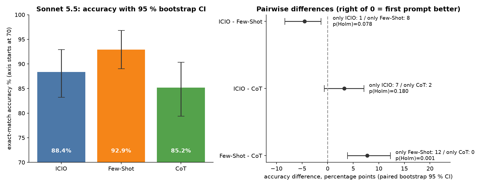
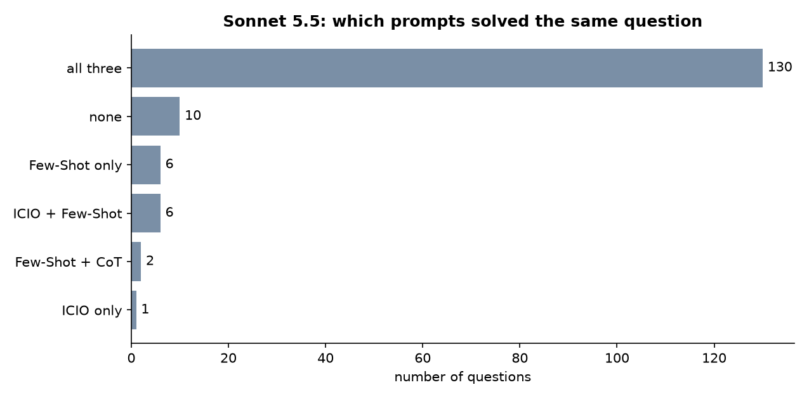
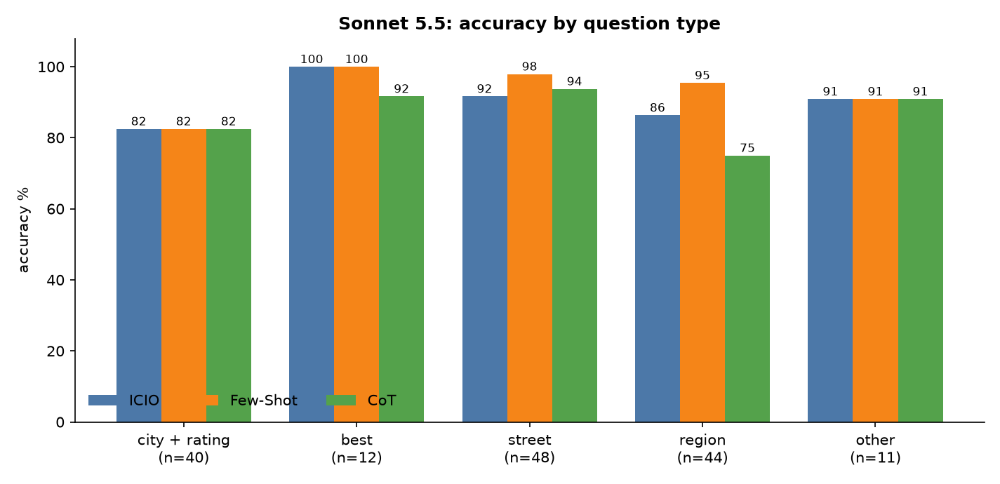
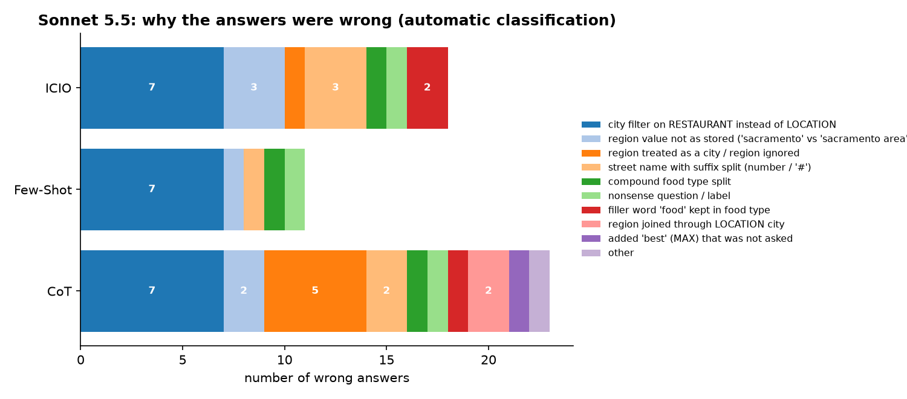
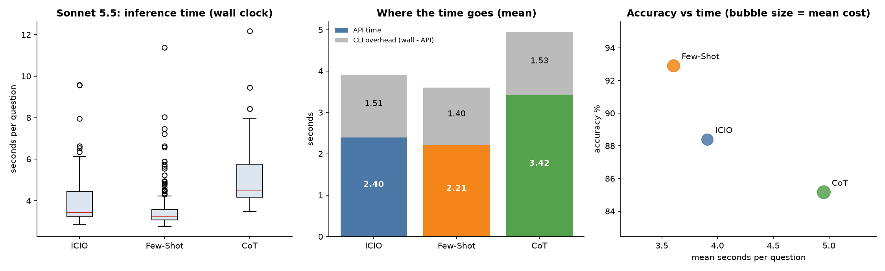

# Task 4 – Detailed analysis of the prompt comparison

Code: [analysis.py](analysis.py) · Generated tables: [output/sonnet-5.5/tables.md](output/sonnet-5.5/tables.md), `output/sonnet-5.5/stats_results.json`, `output/sonnet-5.5/error_causes_per_question.csv` · Figures: `output/sonnet-5.5/fig1…fig5`
Run: `cd Task_4 && ../Task_2/.venv/bin/python analysis.py` (uses only the saved results of Tasks 2 and 3, no new model calls).

## 1. Data and method
Text-to-SQL on the restaurants database, 155 labelled questions, three prompts (ICIO, Few-Shot, CoT), Sonnet 5.5 (effort medium) called through the Claude Code CLI, one run per prompt, one fresh session per call (Task 2). The same 155 questions were given to every prompt, so all comparisons are **paired**.

Tests used:
- **Accuracy (correct/wrong per question):** Cochran's Q for the three prompts together, then exact McNemar tests for each pair (these use only the questions on which two prompts disagree).
- **Row-F1, time, tokens, cost (numeric, paired):** Friedman test, then pairwise Wilcoxon signed-rank tests.
- **Multiple comparisons:** Holm correction over the three pairs of each metric (no correction across metrics).
- **Effect sizes:** differences with 95 % paired bootstrap confidence intervals (10 000 resamples of questions).

## 2. Results

| Prompt | Accuracy [95 % CI] | Row-F1 | Mean time | Median time | Output tokens | Cost / question |
|---|---|---|---|---|---|---|
| ICIO | 88.4 % [83.2, 92.9] | 0.921 | 3.91 s | 3.44 s | 207 | $0.0160 |
| Few-Shot | 92.9 % [88.4, 96.8] | 0.966 | 3.60 s | 3.22 s | 145 | $0.0186 |
| CoT | 85.2 % [79.4, 90.3] | 0.895 | 4.95 s | 4.51 s | 401 | $0.0207 |

### 2.1 Is the difference statistically significant?

**Accuracy.** Cochran's Q = 14.53, df = 2, **p = 0.0007**: the three prompts do not all perform the same.

| Pair | questions only A solved / only B solved | difference A − B [95 % CI] | p | p (Holm) |
|---|---|---|---|---|
| ICIO vs Few-Shot | 1 / 8 | −4.5 pt [−8.4, −1.3] | 0.039 | **0.078** |
| ICIO vs CoT | 7 / 2 | +3.2 pt [−0.6, +7.1] | 0.180 | 0.180 |
| Few-Shot vs CoT | 12 / 0 | +7.7 pt [+3.9, +12.3] | 0.0005 | **0.0015** |

- **Few-Shot > CoT is significant** even after correction (12 questions where only Few-Shot is right, none the other way).
- **Few-Shot > ICIO is suggestive but not significant after Holm correction** (raw p = 0.039, adjusted 0.078). On the row-F1 metric the same pair is significant (p Holm = 0.039), so the evidence is borderline, not absent.
- **ICIO vs CoT is not distinguishable** (7 vs 2 discordant questions, the interval contains 0). Not significant does not mean equal: with only 9 disagreeing questions the test has little power.

**Row-F1** gives the same picture: Friedman p = 0.0011; Few-Shot − CoT +0.071 (p Holm = 0.003), Few-Shot − ICIO +0.045 (0.039), ICIO − CoT +0.026 (0.18).

**Time and tokens.** Differences are highly significant for every pair (all p Holm < 1e-7 for wall time, API time and output tokens): CoT is slower by about 1.0–1.3 s per question and writes 190–260 more output tokens; Few-Shot is faster than ICIO by 0.30 s [0.13, 0.47] and writes 62 fewer tokens. These are consistent length effects (the prompts make the answer longer or shorter on almost every question), so significance is not surprising; what matters is the size: CoT costs about 1.4× the time of Few-Shot and 2.8× its output tokens. **Cost and billed tokens** I do not interpret: they depend on cache writes and reads, which are very uneven between calls (the bootstrap interval of the mean difference of billed tokens contains 0 while the rank test is significant, a sign of a few large cache outliers). Only ICIO being the cheapest per question is stable.

### 2.2 Where the prompts agree and disagree

130 of 155 questions are solved by all three prompts and 10 by none. Only 15 questions separate the prompts: Few-Shot alone solves 6, ICIO and Few-Shot together 6 (CoT fails), Few-Shot with CoT 2 (ICIO fails), ICIO alone 1. The ranking is therefore decided by roughly a dozen questions.

By question type (automatic classification of the question text):

| Type | n | ICIO | Few-Shot | CoT |
|---|---|---|---|---|
| city + rating | 40 | 82.5 % | 82.5 % | 82.5 % |
| best | 12 | 100 % | 100 % | 91.7 % |
| street | 48 | 91.7 % | 97.9 % | 93.8 % |
| region | 44 | 86.4 % | 95.5 % | 75.0 % |
| other | 11 | 90.9 % | 90.9 % | 90.9 % |

The prompts are identical on city questions and differ mainly on **region** questions (CoT 75 %, Few-Shot 95 %) and, less, on street questions.

## 3. Why are the prompts different? Prompt, model and agent as factors

### 3.1 Why the errors happen (all prompts)
I classified every wrong answer by inspecting its SQL (automatic rules, then checked by hand on the shared failures; the cause "city filter" was verified by re-running the SQL with the corrected column).

- **The same 7 questions fail in all three prompts** because the question's city is filtered with `RESTAURANT.CITY_NAME` while the labels use `LOCATION.CITY_NAME`. Switching the column fixes all of them. No prompt told the model which one to use, and the choice the model made is the natural reading of the schema, so this is an **information gap in the prompts, not a reasoning or model failure**. It is the largest cause (7 of 11 errors of Few-Shot) and the floor shared by all prompts.
- One question is nonsense and its label returns every restaurant (label problem).
- All remaining errors are about **conventions of the stored values**, which are only visible in the data: a street stored with its suffix (`san pablo ave # a`, `clayton rd apt 7`), the food type `bar` that the question writes as "bar food", the region values `sacramento area` / `los angeles area` (the question says "sacramento area", the model wrote `sacramento`), and a compound food type `vietnamese/louisiana` that is one value.
- Not a single SQL was invalid (0 of 465). Syntax is not the problem; semantic conventions are.

### 3.2 Prompt factor
Beyond the shared floor, the prompts differ in **how well they transmit the data conventions**:
- **Few-Shot** (11 errors) carries four worked examples. Reading its SQL, the model copies the style of the examples: it turns "tea food" into `FOOD_TYPE = 'tea'` (the example taught that "food" is a filler word), uses street literals as written in the question, joins `GEOGRAPHIC` the same way as in the "bay area" example, and keeps the region phrase of the question ("sacramento area"). Its extra advantage over ICIO is 8 questions of exactly this kind (rows 51, 54, 58, 87, 89, 91, 96, 99 of the dataset, counting from 0).
- **ICIO** (18 errors) gives rules but no demonstration of value conventions: it drops "area" from regions (3), keeps "food" in the food type (2), splits street suffixes (3). Its structure helps with format (always clean SQL), not with data conventions.
- **CoT** (23 errors) has the most errors, and **7 of its errors are region mistakes of a type the others rarely make**: it treats a region as a city (5, e.g. `CITY_NAME = 'monterey'` or no region join at all) and joins `GEOGRAPHIC` through `LOCATION.CITY_NAME` (2); once it also added a `MAX(RATING)` ("best") that was never asked. Its decomposition step "FILTERS: column = value" pushes the model to *interpret* the phrase ("sacramento area" → the city sacramento), which is exactly where the data are unusual. Writing reasoning steps cannot supply information the model does not have; it only gives more room to commit to a wrong interpretation. Region accuracy: CoT 75 %, ICIO 86 %, Few-Shot 95 %.

Caveat: these explanations come from reading the generated SQL and the prompts. I did not run ablations (e.g. Few-Shot without the region example), which would be needed to prove which part of the prompt causes which effect.

### 3.3 Model factor
Only one model (Sonnet 5.5, effort medium) was run, so a model effect **cannot be measured here**, only discussed:
- A strong model clearly masters SQL itself (0 invalid queries, 100 % on "best" questions for two prompts). The remaining errors are not skill errors but knowledge-of-the-data errors, which is why a prompt that adds examples helps and a prompt that adds reasoning does not. A weaker model would probably make more syntax and logic errors, and CoT might then help more; we cannot say from this experiment.
- The model uses very little hidden reasoning for this task (mean 14–36 thinking tokens per call at medium effort), so its answers are mostly produced in one pass. The visible steps of CoT are therefore not replacing hidden ones; they are additional output, which is where the 2–3× tokens and the 1.3 s extra come from.
- Whether the effort level matters (low/high) was not tested.

### 3.4 Coding-agent factor
All calls went through the Claude Code CLI in print mode. What I could observe or control:
- **Overhead.** Wall time minus API time is almost constant, 1.4–1.5 s per call for all prompts (about 40 % of the Few-Shot time). It does not change the ranking but **compresses the relative time differences**: CoT is 1.37× the wall time of Few-Shot but 1.55× its API time.

- **Neutralised agent.** The default system prompt, tools, user and project settings and session history were switched off (`--tools ""`, `--setting-sources ""`, own short system prompt, `--no-session-persistence`), so the agent adds no behaviour of its own. The default agent configuration (a test call showed a context of about 9 000 tokens) would change cost, tokens and possibly answers; this was not measured.
- **Platform safeguard.** My first CoT wording asked for free-form reasoning and the CLI blocked many of those calls (`reasoning_extraction`). The CoT prompt was therefore rewritten as a short, structured decomposition. This means the CoT result is the result of "CoT as the agent allows it", not of an unconstrained chain of thought. A different agent or the raw API might behave differently.
- **Caching and parallelism.** The CLI caches the prompt, and the cost and billed-token figures depend on cache hits. Four calls ran in parallel with the prompts interleaved, so shared load affects all prompts alike but adds noise to individual times.

## 4. Limitations
- **One run per prompt.** The model is not deterministic, and the dataset has no repeated questions, so run-to-run variation was not measured. Differences of 1–2 questions could be partly luck; the safest conclusions are the large ones (Few-Shot vs CoT).
- 155 questions, with only about 15 deciding the ranking; the intervals are wide.
- The error-cause classification and the question-type split are heuristic rules on text and SQL.
- Some labels are doubtful (one nonsense question), and the dataset's conventions are partly hidden, which may favour prompts that happen to show them.
- Significance of time and token differences is easy to obtain, since they are systematic; only the effect sizes are informative.

## 5. Conclusions
1. **Few-Shot is the best prompt on all main criteria:** most accurate (92.9 %), highest F1, fastest, shortest output. It is significantly better than CoT, and probably better than ICIO (suggestive after correction).
2. **CoT is the worst here:** about 1.4× the time and 2.8× the output tokens of Few-Shot for lower accuracy, mostly because the added steps led to wrong interpretations of regions.
3. **ICIO is in between and the cheapest;** it cannot be statistically separated from CoT.
4. **The prompts mainly differ in the information they carry about the data, not in how much they make the model think.** Most errors (the shared floor) come from a single missing fact in all prompts: which city column to use. An obvious next step is to state this and the value conventions in every prompt and to re-run, ideally with a repeated run to measure the random variation.
