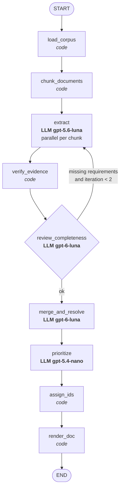

# Architecture of the requirements-refinement network

Input: a directory with arbitrary text documents (`.txt`, `.eml`, `.md`, any structure).
Output: one Markdown document with requirements, a blacklist and a priority scale.

## Graph

Legend: *code* = deterministic node, **LLM** = agentic node.

## Nodes

| # | Node | Type / model | Input -> output | Notes |
|---|---|---|---|---|
| 1 | `load_corpus` | code | `input_dir` -> `documents` | recursive; id = relative path (tracing) |
| 2 | `chunk_documents` | code | `documents` -> `chunks` | lossless split, max 4000 chars, strongest boundary first |
| 3 | `extract` | LLM `gpt-5.6-luna` | chunk (+ reviewer feedback) -> candidate requirements | one call per chunk, fan-out with LangGraph `Send`; schema in `extraction.py` |
| 4 | `verify_evidence` | code | candidates -> verified candidates | normalized substring check of `evidence` in the chunk; adds `source_doc`; drops/flags invented quotes |
| 5 | `review_completeness` | LLM `gpt-6-luna` | document text + its candidates -> verdict + missing items | **feedback loop**: conditional edge back to `extract`, max 2 iterations |
| 6 | `merge_and_resolve` | LLM `gpt-6-luna` | all verified candidates -> merged requirements + blacklist | dedupe (union of sources), conflicts, nonsense, unified vocabulary |
| 7 | `prioritize` | LLM `gpt-5.4-nano` | merged requirements -> + priority | MoSCoW rubric; signals: number of sources, "critical" wording, survey share |
| 8 | `assign_ids` | code | requirements, blacklist -> with `REQ-001` / `BL-001` | IDs assigned after dedup, never by an LLM; ordering by date |
| 9 | `render_doc` | code | final state -> `.md` | also self-checks: every requirement has id, name, paragraph, priority, sources |

Models: 3 distinct (`gpt-5.6-luna`, `gpt-6-luna`, `gpt-5.4-nano`). Chosen from `benchmark_extract.py`
(recall on dense text, verbatim citations, speed).

## State (LangGraph `State`)

`input_dir`, `max_chunk_chars`, `documents`, `chunks`, `candidates`, `review_feedback`
(per document), `iteration`, `requirements`, `blacklist`, `output_path`.

## Requirement record

`id` (code), `title`, `description`, `type`, `priority` (+ rationale), `sources`
(list of `source_doc`), `evidence` (verbatim quotes), `date` (first mention).
Blacklist record: `id`, `title`, `reason`, `conflicts_with`, `sources`.

## Spec coverage

| Spec | Addressed by |
|---|---|
| ANS1 >= 3 LLM nodes | extract, review_completeness, merge_and_resolve, prioritize |
| ANS2 >= 1 code node | load_corpus, chunk_documents, verify_evidence, assign_ids, render_doc |
| ANS3 feedback loop | review_completeness -> extract (conditional edge, capped) |
| ANS4 >= 3 models | gpt-5.6-luna, gpt-6-luna, gpt-5.4-nano |
| ANS5 LangGraph | `StateGraph` in `network.py` |
| OS1 single document | render_doc |
| OS2 unique ID | assign_ids |
| OS3 no duplicates | merge_and_resolve |
| OS4 tracing | chunk.doc_id -> source_doc, evidence verified by verify_evidence |
| OS5 name + paragraph | extract schema (title, description) |
| OS6 priority + scale | prioritize + scale section written by render_doc |
| OS7 consistency | merge_and_resolve (vocabulary, contradictions) |
| OS8 completeness | chunking, review_completeness loop |
| OS9 blacklist | merge_and_resolve + blacklist section in render_doc |

## Known risks

- `merge_and_resolve` sees all requirements at once (~150-250 items, ~30k tokens); fine for this corpus, a larger one needs batching.
- Chunk boundaries can split a heading from its section (seen in the SRS).
- LLM output is non-deterministic; the benchmark was a single run on 3 chunks.
