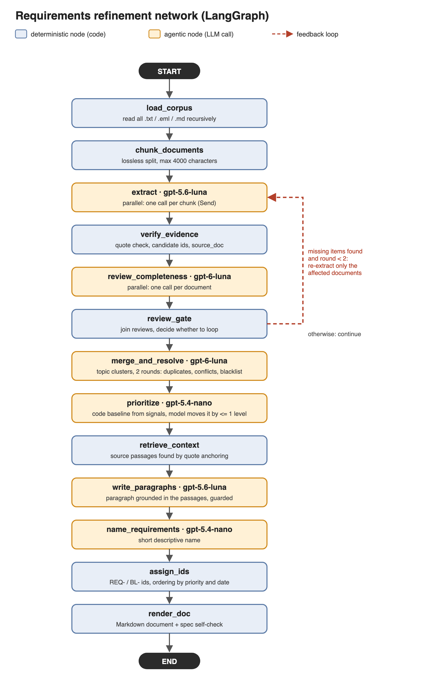

# Requirements refinement network (Week 04, Task 1)

An agentic network in LangGraph that turns a directory of text documents (e-mails, minutes, interviews, a survey,
an SRS draft, reference text) into **one Markdown document of requirements**: unique ids, tracing to the source
documents, a name and a paragraph for each requirement, MoSCoW priorities with an explained scale, and a blacklist
of discarded items with reasons.



## Where to find what

| What | Where |
|---|---|
| **The generated requirements document** | [`output/requirements.md`](output/requirements.md) |
| Analysis of that run against the output specs (OS1-OS9) | [`output/analysis.txt`](output/analysis.txt) |
| **Report** (design choices, decisions, results, limits) | [`report.md`](report.md) |
| The assignment | [`Task_1.md`](Task_1.md) |
| Architecture: node table, state, spec coverage, risks | [`docs/ARCHITECTURE.md`](docs/ARCHITECTURE.md) |
| Network diagram (PNG, SVG and the script that draws it) | `docs/graph.png`, `docs/graph.svg`, `docs/draw_graph.py` |
| Input corpus | `data/corpus/` (the path is a command-line argument, nothing is hard-coded) |

## Code

| File | Contents |
|---|---|
| `network.py` | **Entry point.** `State`, all nodes, the graph (`build_graph`), checkpoints and the CLI |
| `extraction.py` | Requirement schema and the extractor prompt (`extract`) |
| `review.py` | Reviewer prompt and schema (`review_completeness`) |
| `merge.py` | TF-IDF clustering, merge prompt, and the code that applies the model's merge decisions (`merge_and_resolve`) |
| `priority.py` | Priority signals, baseline, clamp, prompt and the priority scale (`prioritize`) |
| `context.py` | Retrieval of source passages by quote anchoring (`retrieve_context`) |
| `elaborate.py` | Paragraph-writer and namer prompts and the guards against invented content |
| `render.py` | `assign_ids`, Markdown rendering and the document self-check (`render_doc`) |
| `textutil.py` | Text normalization shared by the nodes |
| `test_network.py` | 22 offline tests (no API calls): deterministic nodes, guards, the feedback loop with fake LLM nodes |
| `tools/analyze_output.py` | Quality analysis of a finished run (code only, no API calls) |
| `tools/benchmark_extract.py` | Model comparison on the extraction step that led to the model choice |

## Run

```bash
python -m venv .venv && ./.venv/bin/pip install -r requirements.txt
# the OpenAI key is read from a .env file (found by searching upwards from the working directory):
#   OPENAI_API_KEY=...
./.venv/bin/python network.py data/corpus                # full run -> output/requirements.md
./.venv/bin/python -m unittest test_network              # offline tests
./.venv/bin/python tools/analyze_output.py output/states # analysis of the last run
```

A full run takes about 6 minutes and a few hundred API calls (models: gpt-5.6-luna, gpt-6-luna, gpt-5.4-nano).

**Checkpoints.** After every node the whole graph state is saved to `output/states/NN_<node>.json` (git-ignored).
A later stage can be developed or re-run from the saved output of the previous one:

```bash
./.venv/bin/python network.py data/corpus --start-at prioritize                       # resume
./.venv/bin/python network.py data/corpus --start-at review_completeness --stop-after review_gate
```

Stages, in order: `load_corpus`, `chunk_documents`, `extract`, `verify_evidence`, `review_completeness`,
`review_gate`, `merge_and_resolve`, `prioritize`, `retrieve_context`, `write_paragraphs`, `name_requirements`,
`assign_ids`, `render_doc`. Passes of the feedback loop get an `.iN` suffix (`--snapshot-iteration N` picks one).

## Assignment specs at a glance

| Spec | Where |
|---|---|
| ANS1 >= 3 LLM nodes | extract, review_completeness, merge_and_resolve, prioritize, write_paragraphs, name_requirements |
| ANS2 >= 1 deterministic node | load_corpus, chunk_documents, verify_evidence, review_gate, retrieve_context, assign_ids, render_doc |
| ANS3 feedback loop | review_completeness -> review_gate -> extract (max 2 re-extractions) |
| ANS4 >= 3 models | gpt-5.6-luna, gpt-6-luna, gpt-5.4-nano |
| ANS5 LangGraph | `StateGraph` in `network.py` |
| OS1-OS9 | see the spec-coverage table in `docs/ARCHITECTURE.md` and the results in `report.md` |

Note: LLM output is non-deterministic, so a new run gives a similar but not identical document
(three runs: 446, 453 and 421 requirements).
