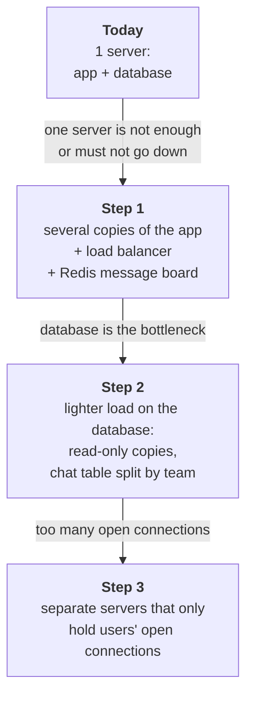
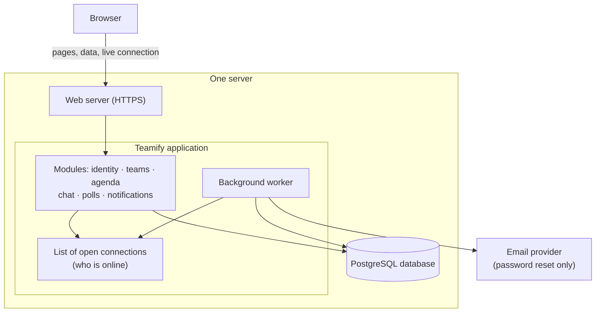
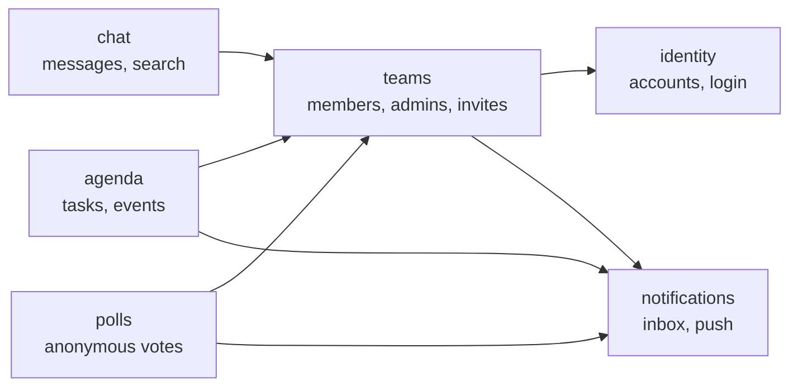
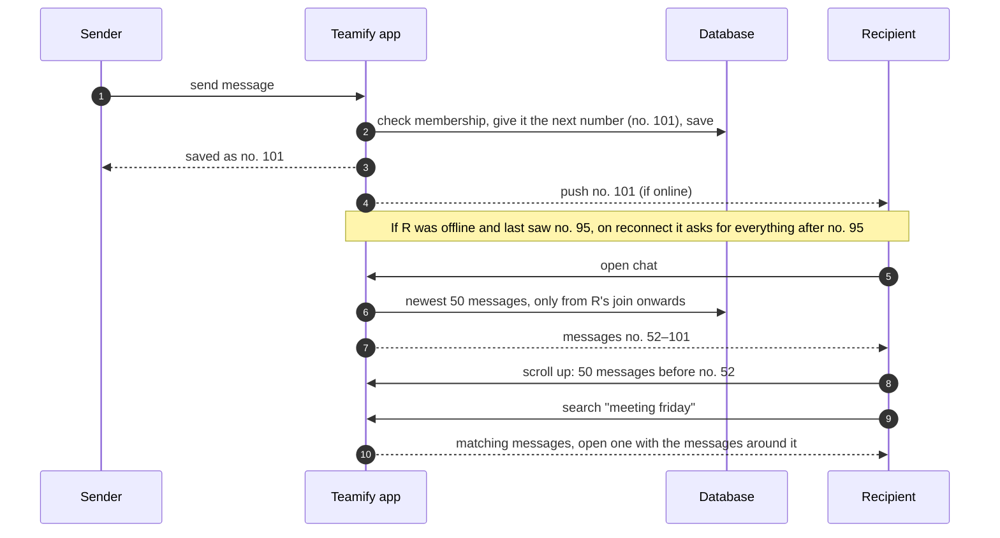

# ADR-001: Teamify architecture – a modular monolith that can grow later

| Field | Value |
|---|---|
| **Status** | Proposed (v4) |
| **Date** | 2026-10-29 |
| **Deciders** | Michal Zrutta (lead), Claude Code (assistant) |
| **Sources** | `data/Teamify.txt` (requirements), `output/Task1_conversation.md` (architecture discussion) |

Technical terms are explained where they first appear and again in the [glossary](#10-glossary).

---

## 1. Context

Teamify is a task-management and team-collaboration app: personal agendas, teams with shared events (accept/refuse), a group chat per team, polls, and in-app notifications with a history.

Most of the app is simple "create / read / update / delete" screens. **The hard part is real-time:** chat messages and notifications must appear on other members' screens immediately, without a page refresh. This needs a **WebSocket**, a connection between the browser and the server that stays open so the server can send ("push") data at any moment.

### 1.1 Constraints
| # | Constraint |
|---|---|
| C1 | **Today: fewer than 50 users.** The system must be **able to grow later** (possibly to national level) without being rewritten. |
| C2 | **Teams are small:** at most 20 members. |
| C3 | Chat and notifications are **real-time**. Offline users must find them later (chat history, notification inbox). Notifications are in-app only; email is used only for password reset. |
| C4 | **Business rules:** a team always has at least one admin; at most 20 members; one vote per member per poll. An admin must name a successor before leaving or deleting their account. |
| C5 | **Joining a team:** the admin invites a user, or the user enters a **team code** / opens an **invite link** from someone. This creates a join request that the admin accepts or rejects. |
| C6 | **Polls are anonymous:** nobody, admins included, sees who voted for what. |
| C7 | **Chat:** the whole history is kept and can be **searched by words**. It loads **in small portions, newest first** (like WhatsApp). **New members see only messages sent after they joined.** |
| C8 | **Deleting an account:** the user's messages and polls stay, shown as "Deleted user"; all other personal data is removed. |
| C9 | **Assumption:** a small development team (1–8 developers) and a small budget. |

---

## 2. Decision drivers
In order of importance:
1. **D1 – Business rules are always correct** (C4, C8), even when two people click at the same moment.
2. **D2 – No real-time message is ever lost** (C3).
3. **D3 – Cheap and simple today:** fast to build, one developer can run it.
4. **D4 – Can grow later without a rewrite** (C1).
5. **D5 – Little operations work, easy to test** on a developer's laptop.
6. **D6 – Low vendor lock-in:** not tied to one cloud provider's special services.

---

## 3. Options considered
| Option | In plain words |
|---|---|
| **#1 Modular monolith** | **One application** and **one database** on one server. Inside, the code is split into separate modules (teams, chat, polls, …) with strict borders between them. |
| **#2 Microservices** | Every module is a **separate application with its own database**. They talk to each other over the network through a message broker (Kafka). Usually runs on Kubernetes. |
| **#3 Serverless / BaaS** | No own server. We use a provider's ready-made building blocks: login, database, real-time messaging (e.g. Supabase or AWS Lambda). We pay per request. |

Full descriptions and trade-offs are in `Task1_conversation.md`, section 3.

---

## 4. Decision

> **We build Teamify as a modular monolith (#1): one application with strict internal modules and one PostgreSQL database, running on one server.**

### 4.1 Why this option
- **It is enough:** 50 users, or even thousands, are a small load for one server.
- **Business rules stay correct easily (D1).** Everything is in one database, so a rule like "the team must keep at least one admin" is checked and saved in **one transaction**, a single step that either fully happens or does not happen at all. In microservices, the same rule spans several databases and needs much more complex code.
- **It is the cheapest and fastest to build and run (D3, D5):** about €5–10 per month for one small server.
- **It can grow (D4):** see 4.2.

### 4.2 How we keep the option to grow
We build only for today's size. But from day one we follow a few **rules that cost almost nothing now** and make later growth possible **by adding servers instead of rewriting code** (section 6).

An example of why this matters: if the app kept chat messages **only in its memory**, a second copy of the app would never see them, and growing would mean rewriting the chat. Because every message is **saved to the database first and only then sent**, a second copy can be added later without code changes.

The growth steps, **only when they are really needed:**

| Step | What we add | Why, in plain words |
|---|---|---|
| **1** | Several copies of the app, a **load balancer** (spreads users across the copies), and **Redis pub/sub** (a fast shared "message board"). | User A may be connected to copy 1 and user B to copy 2. Copy 1 cannot push to B directly, so it posts the message on the board and copy 2 delivers it. *(Earlier versions called this "cross-node delivery".)* |
| **2** | **Read replicas** (read-only copies of the database), a connection pooler, and the chat table split into parts by team. | Reading history and searching then don't slow down writing new messages. |
| **3** | A **realtime gateway**: a group of small servers whose only job is to keep users' WebSocket connections open. | Releasing a new app version no longer disconnects every user. Each part can grow on its own. |

The code, modules and database design stay the same in every step.

---

## 5. How it works today

### 5.1 The system

### 5.2 Modules and their borders
Each module owns its own data. Other modules may only ask it through its public functions (arrows). Only `teams` knows who is a member or admin of a team.

### 5.3 Chat: sending, receiving, loading, searching

---

## 6. Design rules
These rules keep the business rules correct and keep the growth path open.

| # | Rule (plain words) | Technical detail | Why |
|---|---|---|---|
| R1 | Modules talk only through their public functions. | Checked by automated architecture tests; no module reads another module's tables. | D4 |
| R2 | Business rules are checked and saved in one step. | One DB transaction with a row lock (`SELECT … FOR UPDATE`), so two admins leaving at the same moment cannot leave a team without an admin. | D1 |
| R3 | Save first, then send. The database is the truth; a push is only a quick signal. | Each team's messages are numbered (`seq`). A client that misses one notices the gap and asks for "everything after #n". | D2 |
| R4 | A message sent twice (e.g. after a network retry) is saved once. | The client attaches its own message id; the database rejects duplicates. | D2 |
| R5 | Notifications are never lost. | The action and a "to-do" for the notification are saved in the same transaction; the background worker delivers it. | D1, D2 |
| R6 | The app keeps nothing important in memory. | Only the list of open connections lives in memory, behind one interface, so it can move to Redis or a gateway later. | D4 |
| R7 | Chat loads in portions. | 50 messages at a time by message number, never "skip the first N" (stays fast however long the history is). | C7 |
| R8 | Members see only messages sent after they joined. | Each membership stores the message number at the moment of joining; every chat read (load, catch-up, search) filters by it in one place. | C7 |
| R9 | Search finds words in one team's chat. | PostgreSQL full-text search with an index per team; handles diacritics and mixed languages. | C7 |
| R10 | Votes are anonymous. | The voter's id is stored only to allow one vote and changing it; nothing ever shows it. | C6 |
| R11 | Team codes and invite links cannot be guessed. | Random; an admin can revoke them; using one only creates a join request. | C5 |
| R12 | Deleting an account is one step. | One transaction: hand over admin roles, show the author as "Deleted user", delete personal data, close the connections. | C8 |

---

## 7. Comparison
Scores: 1 = poor, 5 = excellent.

| Driver | #1 Modular monolith | #2 Microservices | #3 Serverless / BaaS |
|---|---|---|---|
| D1 Business rules correct | **5** one transaction | 2 rules span several databases | 4 |
| D2 No lost messages | **4** | **4** | 3 connection time limits |
| D3 Cheap and simple today | **5** €5–10 / month | 1 €150–300+ / month | 4 €0–25 / month |
| D4 Can grow later | 4 growth steps 1–3 | **5** | 3 costs rise fast |
| D5 Little operations, easy testing | 4 | 1 | 3 |
| D6 Low vendor lock-in | **5** | 4 | 1 |

*Costs are rough estimates from the Task 1 discussion, not verified.*

---

## 8. Consequences

**Good**
- Fast and cheap to build and run; one developer can manage it.
- Business rules are simple to write and to test.
- Growth means adding servers, not rewriting.

**Accepted downsides**
- **One server is a single point of failure:** if it goes down, Teamify is down. Daily database backups protect the data, not the availability.
- **Every new release briefly disconnects all users;** the app reconnects them automatically.
- **No isolation between modules:** a crash in polls also stops the chat.
- **Module borders can erode** over time if R1 is not enforced.

---

## 9. Why we rejected the other options

**#2 Microservices**
- For 50 users it is a huge overhead: several applications and databases, a message broker and Kubernetes cost €150–300+ per month and much more development time.
- Rules like "the team must keep an admin" or "delete the account" would span several databases and need complex multi-step code (sagas).
- It mainly solves the problem of **many development teams** working in parallel, which Teamify does not have.
- **Kept from #2:** the realtime gateway idea (growth step 3).

**#3 Serverless / BaaS**
- The runner-up: very cheap today, with login and real-time built in.
- Rejected because business rules get spread across database policies and small functions (hard to test), we would be **locked into one provider**, real-time connections have hard time limits, and **costs grow quickly** with many always-open connections.

---

## 10. Glossary
| Term | Meaning |
|---|---|
| **Modular monolith** | One application, internally split into modules with strict borders. |
| **WebSocket** | A connection between browser and server that stays open, so the server can push data at any time. |
| **Push** | The server sends data to the browser without the browser asking. |
| **Transaction** | A group of database changes that either all happen or none of them do. |
| **Row lock** | Makes a second request wait until the first one is finished with the same data. |
| **Load balancer** | Spreads incoming users across several copies of the app. |
| **Redis pub/sub** | A fast shared "message board": one app copy publishes, the others that subscribe receive it. |
| **Read replica** | A read-only copy of the database that takes over reading work. |
| **Realtime gateway** | A group of servers whose only job is to keep users' live connections open and pass messages through. |
| **Full-text search** | Database search for words in text, using an index so it stays fast. |
| **Vendor lock-in** | Being tied to one provider, because moving away would mean rewriting. |
| **Saga** | A business operation spread over several services, done step by step, with undo steps if one fails. |

---

## 11. When to revisit
Write a new ADR if:
- Users grow so much that growth step 3 is not enough.
- The development organisation grows to **~20–30+ developers** or several teams.
- **Teams much larger than 20** members, or email/mobile notifications, become requirements.
- Chat search becomes too slow, or needs features the database search does not have (e.g. typo tolerance). Then add a dedicated search engine.

---

## 12. Open questions
- **Availability:** is it acceptable that Teamify is down while the single server is restarted or repaired? If not, we start directly with growth step 1 (two app copies).
- **Backups:** daily backups mean up to 24 hours of data can be lost after a disk failure. Is that acceptable, or do we need continuous backups?

---

## 13. References
- `data/Teamify.txt` – system description and 31 user stories.
- `output/Task1_conversation.md` – requirements analysis (§2), the three options (§3), comparison (§3.4), Q&A on message flow, account deletion and scaling (§4).
- `output/Task2_conversation.md` – review history of this ADR.
