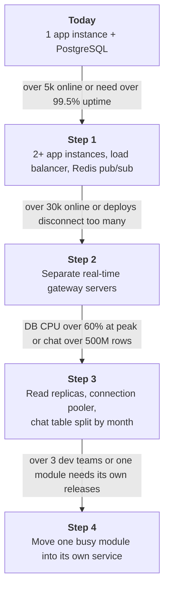
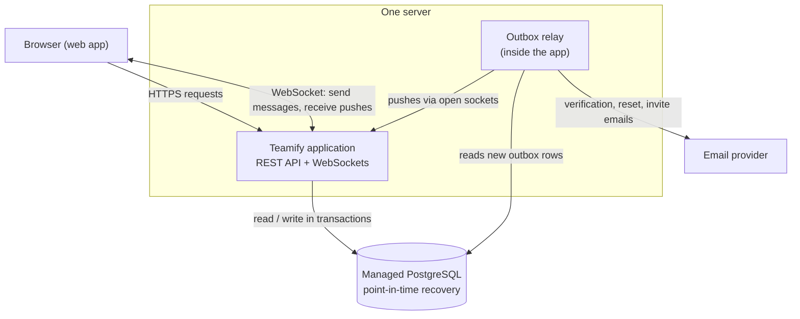
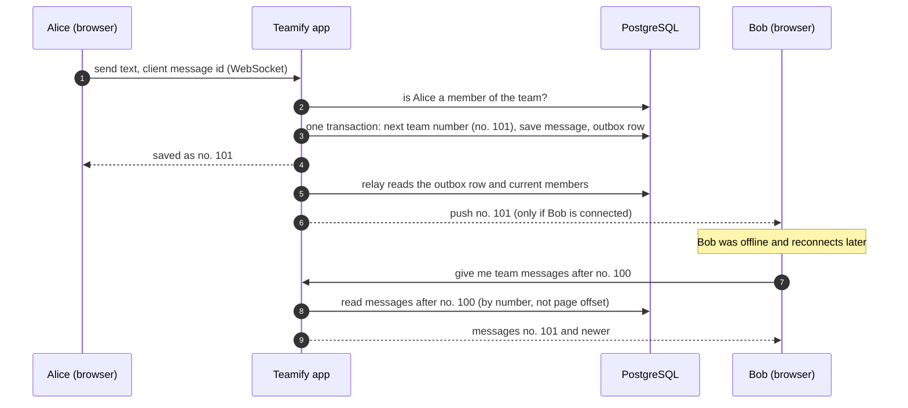

# ADR-001: Teamify architecture – modular monolith on one PostgreSQL database

| Field | Value |
|---|---|
| **Status** | Proposed (v1) |
| **Date** | 2026-10-29 |
| **Deciders** | Michal Zrutta |
| **Sources** | `data/Teamify.txt`, `output/Task3_architecture_discussion.md` |

Technical terms are explained where they first appear and again in the [glossary](#10-glossary).

---

## 1. Context

Teamify is a web application where people manage personal tasks and work in small teams: a shared team agenda of events, a team group chat, polls and notifications (31 user stories in `data/Teamify.txt`).

Most of it is ordinary create/read/update/delete. Two things make it harder:
- **Real-time delivery.** Chat messages and notifications must appear on other people's screens within a second. The server keeps a **WebSocket** open to each signed-in browser (a connection that stays open so the server can send data at any moment) and must not lose anything for people who are offline or briefly disconnected.
- **Rules that span several areas.** "A team always has at least one admin", "a removed member stops seeing the team" and "deleting an account removes the user's data everywhere" touch teams, chat, events, polls and notifications at once, and must stay correct when two people act at the same moment.

### 1.1 Constraints
| # | Constraint |
|---|---|
| C1 | **Launch scale:** up to 2,000 registered users, up to 200 online at once (≈ 1.7 chat messages/s at peak, 12,000/day). Growth to 1 M users / 100k online is possible later but not funded now. |
| C2 | **Teams are small:** at most 50 members; a user is in at most 20 teams. One message reaches at most 49 people. |
| C3 | **Clients:** responsive web app; the server offers a REST API and a WebSocket so mobile apps can be added later. |
| C4 | **Notifications:** in-app (live push + stored inbox). Email only for account verification, password reset and invitations to an email address. No mobile push in v1. |
| C5 | **Team and budget:** 3 developers, no dedicated operations person; ≤ €150/month for infrastructure at launch. |
| C6 | **Availability and data:** 99.5 % per month (≈ 3.6 h downtime). Short disconnects during a deploy are acceptable. Data loss at most 5 minutes (RPO), service back within 4 h after a disaster (RTO). |
| C7 | **Speed:** a chat message or notification reaches online members within 1 s (p95); API calls answer within 300 ms (p95). |
| C8 | **Privacy (GDPR), EU hosting.** Account deletion is immediate: personal data is deleted; messages, events and polls the user wrote stay with the team as "Deleted user"; votes stay as anonymous counts. |
| C9 | **Team rules:** a team always has ≥ 1 admin. The last admin can't leave while others remain; if the last admin deletes the account, the longest-standing member becomes admin, or the team is deleted if nobody is left. Members join only by invitation or an admin's invite code. |
| C10 | **Chat:** text only; members see the full team history; authors may delete their own messages; history lives as long as the team. |

---

## 2. Decision drivers
In order of importance:
1. **D1 – Team rules are always correct**, also under concurrent actions (C9).
2. **D2 – Real-time delivery is reliable:** fast for online users, nothing lost for offline users (C4, C7).
3. **D3 – Small team, small budget:** quick to build, easy to run (C5, C6).
4. **D4 – Account deletion is complete and immediate** (C8).
5. **D5 – Growth to large scale without a rewrite** (C1).
6. **D6 – Easy to test locally, little vendor lock-in** (C5).

---

## 3. Options considered
| Option | In plain words |
|---|---|
| **#1 Modular monolith** | One application and one PostgreSQL database. The code is split into modules by business area; each module owns its tables. The app also holds the WebSockets. |
| **#2 Microservices + event bus** | Seven services, each with its own database, exchanging events through a message broker; a separate gateway holds the WebSockets. Runs on Kubernetes. |
| **#3 Serverless / BaaS** | Managed building blocks instead of our own server: **3A** Supabase (database, auth, realtime, rules written as database policies) or **3B** AWS Lambda + API Gateway WebSockets + DynamoDB. |

Full descriptions, flows and trade-offs are in `output/Task3_architecture_discussion.md`, sections 2 and 3.

---

## 4. Decision

> **We build Teamify as a modular monolith: one application with clearly separated modules, one PostgreSQL database, and WebSockets served by the application itself.**

### 4.1 Why this option
- **Every team rule is one transaction (D1, D4).** A *transaction* is a group of database changes that happens completely or not at all. Promoting a new admin, deleting an account across all areas, or deleting a team are each one transaction with *row locks* (two concurrent actions on the same team wait for each other instead of both succeeding). With separate databases (#2, #3B) the same operations become multi-step workflows that can stop halfway.
- **Reliable delivery is simple when the database is the truth (D2).** A message is saved first and pushed second. If a push is lost, the browser asks "what did I miss since message no. N?" when it reconnects.
- **It fits 3 developers and the budget (D3).** One deployable, one database, one log; about €100/month (rough estimate). #2 would cost ≈ €1,000+/month and a full-time operations effort.
- **It runs on a laptop (D6).** The app and a PostgreSQL container are the whole system; nothing depends on one cloud vendor.
- **The load is small (C1, C2).** At launch ≈ 2 messages/s and 200 connections; even at 1 M users the write load (≈ 1k/s at peak) fits one PostgreSQL primary.

### 4.2 How we keep the option to grow
We build only for today's size. But from day one we follow a few **rules that cost almost nothing now** and make later growth possible **by adding servers instead of rewriting code** (section 6).

An example of why this matters: if "who is online and which messages still need pushing" lived only in the application's memory, a second copy of the application could not know about the first copy's users, and a message sent on copy A would never reach a user connected to copy B. Growing would mean rewriting the delivery code. Because every push starts from a row in the database (R4) and the in-memory list of connections is only a cache (R5), adding a second copy only needs a small message channel between the copies.

| Step | What we add | Why, in plain words |
|---|---|---|
| **1** | A second app instance behind a load balancer; Redis pub/sub between instances. | If one machine fails, the other keeps working; a push reaches users on any instance. |
| **2** | Gateway servers that only hold WebSockets and forward messages to the app. | Open connections grow much faster than real work; they get their own cheap machines, and deploying the app no longer disconnects users. |
| **3** | Read-only database copies, a connection pooler, monthly partitions of the chat table. | Reading agendas and history moves off the main database; the chat table stays fast as it grows. |
| **4** | One module (most likely Chat) becomes its own service. | Only when several dev teams need independent releases. Module borders (R1) make this a cut, not a rewrite. |

---

## 5. How it works today

### 5.1 The system

### 5.2 Modules and their borders
Each module owns its tables. Other modules call it only through its public interface; no module reads another module's tables.

| Module | Owns | Used by |
|---|---|---|
| Identity | users, sessions, reset tokens | all (who is the caller?) |
| Teams | teams, memberships, invitations, invite codes | Chat, Events, Polls, Notifications (is this user a member/admin?) |
| Agenda | personal tasks | – (reads Events for "my accepted events") |
| Events | events, event responses | Agenda |
| Chat | messages, per-member read position | – |
| Polls | polls, options, votes | – |
| Notifications | inbox entries, outbox | all (they write notifications and outbox rows) |
| Realtime | open WebSockets (memory only) | Notifications' relay |

Account deletion is owned by Identity: it calls a "user is being deleted" function of every module inside **one** transaction (R7).

### 5.3 One chat message, including a member who was offline

---

## 6. Design rules
These rules keep the business rules correct and keep the growth path open.

| # | Rule (plain words) | Technical detail | Why |
|---|---|---|---|
| R1 | Modules don't touch each other's data. | Each module has its own schema; architecture tests in CI fail on cross-module table access or imports of non-public code. | D5, D6 |
| R2 | Team rules are checked inside the change that could break them. | "≥ 1 admin": lock the team's admin memberships with `SELECT … FOR UPDATE` in the same transaction as leave/demote/delete. | D1, C9 |
| R3 | Every chat message has a team-wide number, and sending twice saves once. | Number from `UPDATE teams SET last_chat_seq = last_chat_seq + 1 RETURNING` in the insert transaction; `UNIQUE(team_id, client_msg_id)` makes retries harmless. | D2 |
| R4 | Save first, push second – from one place only. | Any change that others must hear about writes its notification rows and an **outbox** row in the same transaction. Only the relay pushes and sends emails; it is woken after each commit and also polls every second. Clients ignore duplicates by message number / notification id. | D2, D5 |
| R5 | Nothing important lives only in memory. | The list of open sockets is a cache rebuilt on reconnect; unread counts, notifications and messages are in the database. | D5 |
| R6 | Membership is checked on every request and every push. | One `Teams.check(user, team, role)` function; when a member leaves or is removed, their subscription to the team is closed at once. | D1 |
| R7 | Account deletion is one command that reaches every module. | Identity calls each module's `onUserDeleted` in one transaction; a test fails if a table referencing users has no handler. | D4, C8 |
| R8 | A reconnecting browser catches up by number. | Client sends its last number per team; server returns newer messages using keyset pagination (`WHERE seq > ?`, never `OFFSET`). | D2 |
| R9 | Reads that must see the newest data go to the main database. | Applies from growth step 3: catch-up and permission checks never use a read replica, which may lag behind. | D2 |
| R10 | Signing out really signs out. | 15-minute access token + refresh token stored on the server; logout, password change and deletion revoke it and close the user's WebSockets. | D1, C8 |
| R11 | Slow or external work never runs inside a user's request. | Emails are sent only by the relay, with retries and backoff; a slow email provider never delays an API call. | C7 |

---

## 7. Comparison
Scores: 1 = poor, 5 = excellent.

| Driver | #1 Modular monolith | #2 Microservices | #3A Supabase | #3B AWS serverless |
|---|---|---|---|---|
| D1 Correct team rules | **5** one transaction, row locks | 2 copies of membership data, multi-step workflows | 3 one DB, rules spread over policies and functions | 2 no joins, conditional writes |
| D2 Reliable real-time | **4** save-then-push, catch-up; one server | **4** dedicated gateway, more moving parts | 3 built-in realtime, own catch-up | 3 2 h connection limit, 10 min idle limit |
| D3 Small team & budget | **5** one deploy, ≈ €100/month | 1 Kubernetes + broker, ≈ €1,000+/month | 4 fastest start, ≈ €25/month | 3 cheap, steep learning curve |
| D4 Complete deletion | **5** one transaction | 2 workflow across 7 databases | 4 one SQL function + auth call | 2 batches of ≤ 100 items |
| D5 Growth without rewrite | 4 add Redis, gateway, replicas | **5** built for it | 3 pricing limits; self-hosting possible | 4 scales by itself, cost grows |
| D6 Local testing, lock-in | **5** app + PostgreSQL | 2 whole fleet or contract tests | 3 local CLI; logic in SQL | 1 emulators only |

*Costs are rough estimates, not verified.*

---

## 8. Consequences

**Good**
- Business rules (admins, membership, deletion) are simple to write, review and test.
- One deployment, one log, one database backup; three developers can run it.
- Infrastructure ≈ €100/month at launch.
- A clear, stepwise path to large scale (section 4.2).

**Accepted downsides**
- **One server is a single point of failure.** If it fails, Teamify is down until it restarts (automatic restart within minutes; backups protect the data, not availability). Accepted within 99.5 % (C6); step 1 removes it.
- **Each deploy disconnects everyone for a few seconds.** Browsers reconnect with a random delay and catch up (R8).
- **Module borders can erode** if the architecture tests (R1) are ignored; then growth step 4 becomes expensive.
- **No independent scaling or failure isolation** between modules: a memory leak in chat takes down the agenda too.

---

## 9. Why we rejected the other options

**#2 Microservices + event bus**
- Solves organisational scale (many dev teams), which Teamify doesn't have; the load never requires it (C1, C2).
- Admin succession and account deletion become multi-step workflows (sagas) across databases (D1, D4).
- Kubernetes, a broker and seven databases are too much to run for three developers (D3).
- **Kept from #2:** the outbox pattern (R4), duplicate-safe consumers (R3, R4), and the separate real-time gateway as growth step 2.

**#3A Supabase** (runner-up for launch)
- Fastest start, but business rules would be split between database policies, triggers and functions, which are hard to review and test (D1); medium lock-in (D6).
- **Kept from #3:** managed database and managed email instead of running them ourselves.

**#3B AWS serverless**
- Relational rules fit DynamoDB poorly (D1, D4); WebSocket limits (2 h maximum, 10 min idle) fight a chat product (D2); highest lock-in (D6).

---

## 10. Glossary
| Term | Meaning |
|---|---|
| Modular monolith | One deployable application whose code is split into modules by business area, each owning its data. |
| Module | One business area (e.g. Teams) with its own tables and a public interface. |
| WebSocket | A browser–server connection that stays open so the server can send data at any time. |
| Push | A message the server sends without being asked. |
| Transaction | A group of database changes that happens completely or not at all. |
| Row lock | `SELECT … FOR UPDATE`: other transactions touching the same rows wait. |
| Outbox | A table written in the same transaction as a business change; a relay later delivers its rows, so "saved" and "will be delivered" never diverge. |
| Relay | The background part of the app that reads outbox rows and pushes notifications or sends emails. |
| Sequence number | A per-team counter (no. 1, 2, 3 …) that orders messages and shows gaps. |
| Idempotent | Doing it twice has the same effect as doing it once. |
| Keyset pagination | Reading "the next items after number N" instead of "skip N rows"; stays fast on large tables. |
| Pub/sub (Redis) | Publish a message once; every subscribed app instance receives it. |
| Load balancer | Spreads incoming connections over several servers. |
| Read replica | A read-only copy of the database that follows the main one with a small delay. |
| Saga | A business operation split into steps in different services, with undo steps on failure. |
| RPO / RTO | Maximum data loss / maximum time to restore service after a disaster. |
| BaaS | Backend-as-a-Service: ready-made auth, database and realtime from a provider. |
| Row-level security (RLS) | Database rules that decide which rows each user may read or write. |

---

## 11. When to revisit
Write a new ADR if:
- more than 3 development teams work on Teamify, or one module needs its own release schedule;
- availability above 99.5 % becomes a contractual requirement;
- new features change the load profile (e.g. file sharing, video calls, public teams with thousands of members);
- the growth triggers in section 4.2 are reached faster than the steps can be built.

---

## 12. References
- `data/Teamify.txt` – requirements and user stories.
- `output/Task3_architecture_discussion.md` – requirements study, gap decisions, sizing, options, deep-dive questions (sections 1–4).
- `output/Task3_architecture_discussion.md`, section 5 – review history of this ADR.
