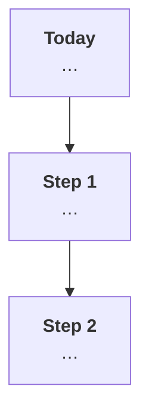
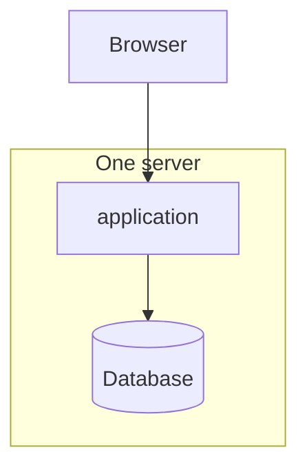
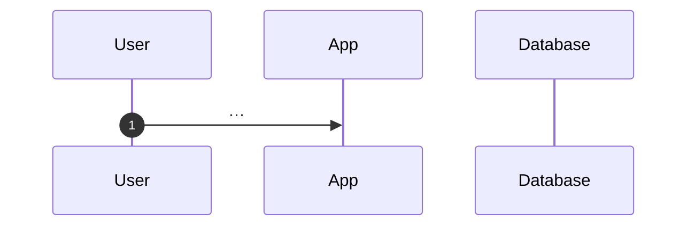

# ADR-<NNN>: <System> architecture – <decision in a few words>

| Field | Value |
|---|---|
| **Status** | Proposed (v1) |
| **Date** | <YYYY-MM-DD> |
| **Deciders** | <names> |
| **Sources** | `<requirements file>`, `<discussion notes file>` |

Technical terms are explained where they first appear and again in the [glossary](#10-glossary).

---

## 1. Context

<What the system is, in 2–3 sentences.>

<The hard part, in plain words: what makes this system more than CRUD, and what that requires (explain the key technical term here).>

### 1.1 Size today and growth target
| | Today | Growth target |
|---|---|---|
| Registered users | … | … |
| Online at the same time (peak) | … | … |
| Peak load (e.g. messages/s) | … | … |
| Storage per year | … | … |

### 1.2 Constraints
| # | Constraint |
|---|---|
| C1 | **Scale:** we build for <today>; the design must reach <growth target> by adding infrastructure, not by rewriting. |
| C2 | … |
| Cn | **<Decided gap, e.g. dev team size, budget, acceptable downtime>:** <the decision>. |

---

## 2. Decision drivers
In order of importance:
1. **D1 – <driver in plain words>** (C…).
2. **D2 – …**

---

## 3. Options considered
| Option | In plain words |
|---|---|
| **#1 <name>** | … |
| **#2 <name>** | … |
| **#3 <name>** | … |

Full descriptions and trade-offs are in `<discussion notes>`, section <n>.

---

## 4. Decision

> **We build <System> as <option>: <one sentence>.**

### 4.1 Why this option
- **<Reason> (D…).** <Plain explanation, with the technical term explained.>
- …

### 4.2 How we keep the option to grow
We build only for today's size. But from day one we follow a few **rules that cost almost nothing now** and make later growth possible **by adding servers instead of rewriting code** (section 6).

An example of why this matters: <concrete "if we did X, growing would require a rewrite" example>.

| Step | What we add | Why, in plain words | Size it makes possible |
|---|---|---|---|
| **1** | … | … | up to … online |

---

## 5. How it works today

### 5.1 The system

### 5.2 Modules and their borders
<Who owns which data; which module may call which.>

### 5.3 <The hardest flow>

---

## 6. Design rules
These rules keep the business rules correct and keep the growth path open.

| # | Rule (plain words) | Technical detail | Why |
|---|---|---|---|
| R1 | … | … | D… |

---

## 7. Comparison
Scores: 1 = poor, 5 = excellent.

| Driver | #1 | #2 | #3 |
|---|---|---|---|
| D1 … | **5** <few words> | … | … |

*Costs are rough estimates, not verified.*

---

## 8. Consequences

**Good**
- …

**Accepted downsides**
- …

---

## 9. Why we rejected the other options

**#2 <name>**
- …
- **Kept from #2:** …

**#3 <name>**
- …

---

## 10. Glossary
| Term | Meaning |
|---|---|
| … | … |

---

## 11. When to revisit
Write a new ADR if:
- <observable trigger>

---

## 12. References
- `<requirements>` – …
- `<discussion notes>` – …
- `<review log>` – review history of this ADR.
