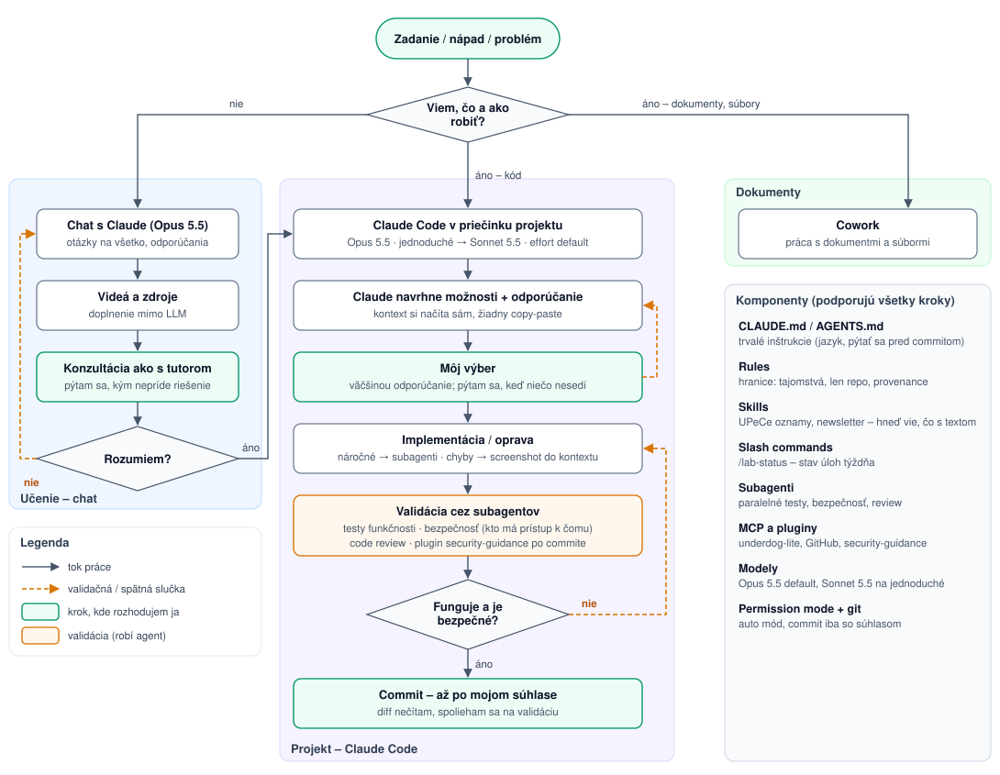

<!-- Created by Claude Code (claude-opus-5-5) on 2026-11-26 -->
# Task 10 (bonus) – Môj workflow s LLM

**V skratke:** Používam iba Claude, a to v desktop aplikácii. Tá zvládne to isté ako terminál aj web. Nástroj vyberám podľa toho, či viem, čo chcem urobiť. Copy-paste medzi nástrojmi už nerobím. Testy a bezpečnosť overujú subagenti, ja robím rozhodnutia.

## Výber nástroja

| Situácia | Nástroj | Model |
|---|---|---|
| neviem, čo a ako (zadanie, nová téma) | chat | Opus 5.5 |
| viem čo, ide o kód alebo projekt | Claude Code v priečinku projektu | Opus 5.5, jednoduché úlohy Sonnet 5.5 |
| dokumenty a súbory | Cowork | podľa úlohy |

Effort takmer nemením, ostáva na predvolenom nastavení. Subagentom niekedy nechám vybrať model podľa dôležitosti úlohy (Opus, Sonnet, Haiku).

## Slučka 1: učenie (chat)

1. Keď zadaniu nerozumiem, v chate sa pýtam na všetko, čo potrebujem vedieť, a pýtam si odporúčania.
2. Pozriem si videá a ďalšie zdroje mimo LLM.
3. Potom konzultujem s Claude ako s tutorom, kým nedôjdem k riešeniu.
4. Ak stále nerozumiem, vrátim sa na bod 1. Ak rozumiem, prejdem do slučky 2.

## Slučka 2: projekt (Claude Code)

1. Otvorím Claude Code v priečinku projektu a komunikujem iteratívne. Kontext si načíta sám, takže nič nekopírujem.
2. Vždy si pýtam viac možností aj s odporúčaním. Väčšinou vyberiem odporúčanú. Keď mi niečo nesedí, pýtam sa ďalej, kým to nemám premyslené aj sám.
3. Pri náročných úlohách poviem, nech použije subagentov.
4. **Validácia:** Diff nečítam. Validáciu nechávam na agentoch:
   - subagenti spravia testy a overia, či všetko funguje,
   - samostatná bezpečnostná kontrola (napríklad paralelní subagenti: endpointy, tokeny v odkazoch, CSRF, oprávnenia, escapovanie výstupu),
   - code review a plugin `security-guidance`, ktorý po commite automaticky hlási nálezy,
   - pri chybách alebo zlom vzhľade pošlem screenshot do kontextu.
5. Keď niečo nefunguje alebo nie je bezpečné, nasleduje oprava a nová validácia. Commit robím až po mojom súhlase.

## Kde LLM najčastejšie robí chyby

- **Funkčnosť:** kód vyzerá hotovo, ale časť funkcionality nefunguje.
- **Bezpečnosť, hlavne prístupy:** ľudia sa dostanú k tomu, k čomu by nemali. Príklad z webu pre dobrovoľníctvo: rezervácie cez odkazy s tokenom (`?rezervacia=`, `?zrusit=`) a admin akcie bez kontroly oprávnení. Preto bezpečnosť kontrolujem vždy zvlášť.

## Komponenty

| Komponent | Úloha vo workflowe |
|---|---|
| `CLAUDE.md` / `AGENTS.md` | trvalé inštrukcie: jazyk, pýtať sa pred commitom, konvencie projektu |
| rules (`.claude/rules/`) | hranice: tajomstvá, práca len v repe, provenance súborov |
| skills | pri dobrovoľníctve (UPeCe oznamy, newsletter) Claude z textu hneď vie, čo má vyrobiť |
| slash commands | opakované príkazy, napríklad `/lab-status` |
| subagenti | paralelné testy, bezpečnosť a review |
| MCP a pluginy | vlastný MCP server, GitHub, `security-guidance` |
| permission mode a git | auto mód na rýchlosť, git a súhlas pred commitom ako poistka |

## Prečo nie copy-paste

Predtým bolo kopírovanie medzi nástrojmi nutné. Teraz je zbytočné, pretože Claude Code si súbory, chyby a výstupy načíta sám. Zo vstupov dodávam iba screenshoty a vlastné rozhodnutia.
